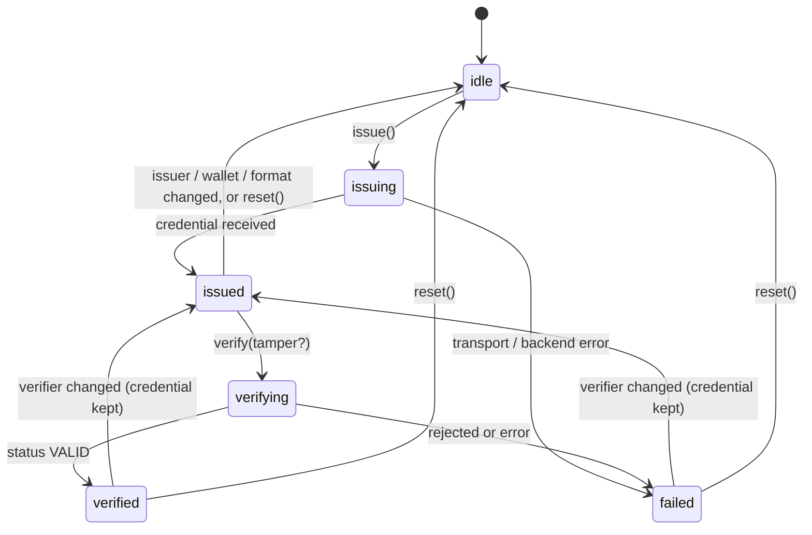
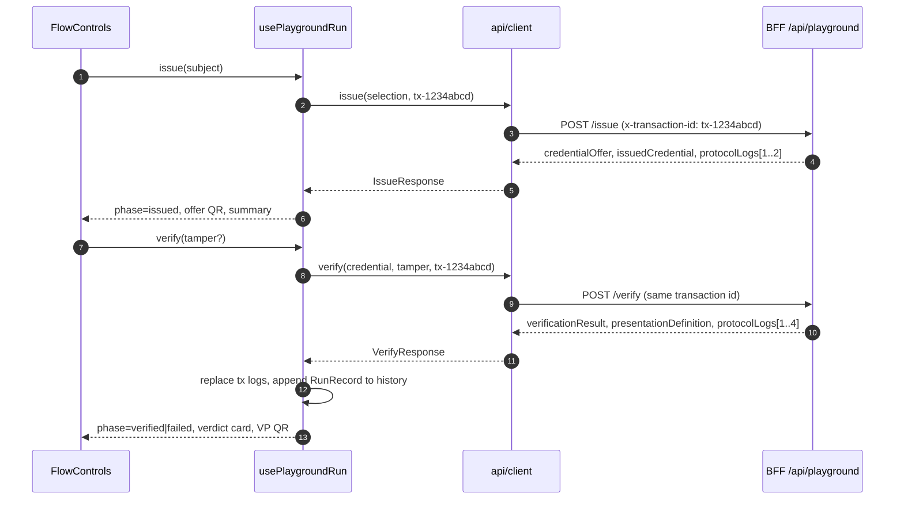

# MOSIP VC Interoperability Playground — Architecture & Protocol Specs

## Overview

The **MOSIP Verifiable Credential (VC) Interoperability Playground** is an interactive, developer-first workbench for checking that credentials interoperate across standard digital identity protocols and credential formats, between MOSIP's Inji stack and independent standards-compliant implementations.

### Core objectives

1. **Multi-party matrix execution:** select and run any combination of issuer, wallet and verifier.
2. **Two credential standards:** **W3C VC (JSON-LD)** and **IETF SD-JWT VC** (selective disclosure), labelled on every run.
3. **Protocol transparency:** inspect the wire payloads of **OpenID4VCI (Draft 13)** and **OpenID4VP (Draft 21)** per run.
4. **Negative paths:** show that verifiers reject expired and signature-tampered credentials.
5. **Evidence:** produce a pass/fail interoperability report from real runs, exportable as Markdown or JSON.

---

## System component topology

```text
+-----------------------------------------------------------------------------------+
|                         Browser Client (React 19 + Vite 8)                        |
|   - 3-Column Matrix Selector + status badges (Amogh)                              |
|   - Flow Controls: QR offers, tamper mode, results (Amogh)                        |
|   - Interop Report + run history (Amogh)                                          |
|   - Mermaid.js Sequence Visualizer, Live Protocol Inspector (Ayaan)               |
+-----------------------------------------------------------------------------------+
                                        |  HTTP / REST (/api/playground)
                                        |  one x-transaction-id per run
                                        v
+-----------------------------------------------------------------------------------+
|                      Node.js / Express 5 BFF Orchestrator                         |
|   - In-Memory Protocol Audit Logger (Aatraya)                                     |
|   - Mock Standards Protocol Engine (Aryan)                                        |
|   - Proxy Gateway to MOSIP Collab Sandbox (Aatraya)                               |
+-----------------------------------------------------------------------------------+
                  |                                           |
                  | OpenID4VCI / OpenID4VP                    | OpenID4VCI / OpenID4VP
                  v                                           v
+-----------------------------------+       +---------------------------------------+
|       MOSIP Collab Sandbox        |       |        Standards Mock Engine          |
|  - Inji Certify (Issuance)        |       |  - OpenID4VCI Draft-13 Issuer         |
|  - Inji Mimoto (Wallet Gateway)   |       |  - OpenID4VP Draft-21 Verifier        |
|  - Inji Verify (Verification)     |       |  - Edge-case / Tamper Generator       |
+-----------------------------------+       +---------------------------------------+
```

### Live MOSIP Collab calls

`backend/src/services/collab.ts` talks to the Collab sandbox (endpoints from `collabTargets()`, overridable with `MOSIP_INJI_*_URL`). Each call is recorded as a `ProtocolLog` with `live: true` as soon as it returns, so it also reaches the UI over SSE.

- **Inji Certify with a test identity** (`COLLAB_TEST_INDIVIDUAL_ID`, W3C; `services/injiIssuance.ts`):
  - eSignet (`esignet-mock`): CSRF cookie, then `oauth-details` as Mimoto's client with PKCE, binding later calls with `oauth-details-key/-hash`. Then OTP send, authenticate and the authorization code.
  - Token from Mimoto's `get-token/{issuer}` proxy, which signs the client assertion.
  - Inji Certify (Land Registry): `c_nonce` from its Nonce Endpoint, and an OpenID4VCI 1.0 credential request (`credential_configuration_id`, `proofs.jwt`) with the wallet's ES256 proof.
  - Each step is a live log; secrets are redacted. A refusal falls back to the path below, with the failing step in the notice.
- **Inji Certify** otherwise (`/issue`, issuer `inji-certify`): fetch issuer metadata, find a configuration for the requested format, then send the credential request. Certify refuses it without an eSignet access token (403), so the BFF emulates the credential and returns a notice saying so, with `isSandboxFallback: true`. The credential endpoint is only called on the issuer's own origin.
- **Mimoto** (wallet `inji-wallet`): look up the issuer in Mimoto's registry.
- **Inji Verify** (`/verify`, verifier `inji-verify`): `POST /v1/verify/v2/vc-verification` with the credential (JSON-LD as a string, or a compact SD-JWT). It reports schema and signature, expiry and status checks separately, plus the claims; those become the verdict, checks and shared claims. Where v2 is missing, v1 (`/vc-verification`, one overall `verificationStatus`) is used. In tamper mode the wallet sends a really tampered credential first (see below).

### Mock engine (real cryptography)

- **Issuer** (`mocks/mockService.ts`, `mocks/crypto.ts`, `mocks/mdoc.ts`): W3C credentials signed with `Ed25519Signature2020` by a `did:key` issuer (inline JSON-LD context for the claims); SD-JWT VCs signed ES256 with a self-signed `x5c` certificate and the holder key in `cnf`; mDocs with a COSE_Sign1 Mobile Security Object. Keys are generated once per BFF process.
- **Wallet** (`mocks/wallet.ts`): answers each authorization request with a presentation bound to its nonce: a signed W3C presentation (`challenge`, `domain`), an SD-JWT with only the requested disclosures and a key-binding JWT, or an mDoc DeviceResponse with a device signature. Tamper options are applied for real: the issuer re-issues an expired or wrong-type credential, signature bytes are altered, or an earlier nonce is reused.
- **Verifier**: single-use nonces (10 minutes); checks holder binding, issuer signature and trust list (the mock issuer only), disclosures or element digests, expiry and type. The JSON-LD loader resolves bundled contexts and `did:key` only, so a credential can never make the BFF fetch a URL.

When a Collab service is unreachable or answers without JSON, the BFF answers from the mock engine instead, relabels the emulated participant as "(Collab Sandbox Emulated)" and sets `isSandboxFallback: true` with a notice. The UI shows an **Emulated** badge and a banner with the BFF's reason, and the report flags those runs. What is live and what is emulated today is summarised in [known-issues.md](./known-issues.md#what-runs-live-today).

> **Subsystem deep-dive:** specifications and Mermaid diagrams for the audit logger are in [audit-logger-architecture.md](./audit-logger-architecture.md).

---

## Supported protocols & formats

### 1. OpenID for Verifiable Credential Issuance (OpenID4VCI — Draft 13)

- **Endpoint discovery:** `/.well-known/openid-credential-issuer`
- **Credential offer:**
  - URI: `openid-credential-offer://?credential_offer=<url-encoded JSON>`. The UI renders it as a QR code and a same-device deep link.
  - Grant: `urn:ietf:params:oauth:grant-type:pre-authorized_code`
  - Configuration IDs: `NationalId_W3C_JSONLD`, `NationalId_SD_JWT`
- **Credential request:**
  - Formats: `ldp_vc` (W3C Linked Data Proof) and `vc+sd-jwt` (IETF Selective Disclosure JWT)
  - Proof of possession: JWT (`proof_type: jwt`)

### 2. OpenID for Verifiable Presentations (OpenID4VP — Draft 21)

- **Authorization request:**
  - URI: `openid4vp://authorize?response_type=vp_token&response_mode=direct_post&client_id=…&nonce=…&presentation_definition=…`
  - The UI renders it as a QR code (cross-device) and a deep link (same-device). `/verify` returns the verifier's `nonce` and `client_id` alongside the presentation definition (for Inji Verify, its origin); the UI uses these values, with registry/transaction fallbacks for response shapes that omit them. The nonce is not yet bound to the presentation (S-1).
  - The presentation definition requests `fullName` and `nationalId` and accepts the `ES256` and `EdDSA` algorithms.
- **Presentation submission:**
  - Envelope: `vp_token` posted to the verifier's response endpoint
  - Checks: format, signature, expiry and schema, each reported separately

### 3. Credential formats

| Format | Wire format | Proof shown in UI | Notes |
| --- | --- | --- | --- |
| W3C VC 1.1 (JSON-LD) | `ldp_vc` | `proof.type`, e.g. `Ed25519Signature2020` | `@context`, `credentialSubject`, `expirationDate` |
| IETF SD-JWT VC | `vc+sd-jwt` | `JWT (<alg>)`, e.g. `JWT (ES256)` | `header.payload.signature~disclosure~…`; the UI decodes `iss`, `vct`, `exp` and counts disclosures |

---

## Frontend architecture

### Module layout

| Module | Responsibility |
| --- | --- |
| `config/nodes.ts` | **Registry** of issuers, wallets, verifiers and formats (labels, badges, supported formats, OpenID4VP `client_id`). `allCombinations()` builds the issuer × wallet × verifier × format product used by the report and the batch runner. |
| `api/client.ts` | Typed BFF client. Sends `x-transaction-id`, turns `success:false` or non-2xx responses into `ApiError` carrying the backend message, and explains when the BFF is unreachable. |
| `hooks/usePlaygroundRun.ts` | **Single source of truth** for a run: selection, phase, payloads, logs and run history. Components only render this state and call its actions. |
| `config/scenarios.ts` | One-click presets for TC-01 to TC-05: each sets a matrix selection and the tamper options it applies. |
| `components/MatrixSelector.tsx` | Role columns built from the registry, live status badges, per-role **Emulated** badges, format toggle. |
| `components/FlowControls.tsx` + `components/flow/*` | Composition of `ScenarioBar`, `TamperOptions`, `IssuePhase` (subject editor, offer QR, `CredentialSummary`, `CredentialInspector`) and `PresentPhase` (request QR, `VerdictCard`, `SharedClaimsPanel`). Controlled by `RunInputs` held in `App.tsx`. |
| `components/RunTimeline.tsx`, `RunPlayer.tsx` | Accessible step list (also the phone view) and replay controls; the replay slice feeds the diagram and inspector. |
| `components/InteropMatrixReport.tsx`, `report/InteropHeatmap.tsx` | Heatmap / list matrix, real vs emulated scores, run history with filters (including layer and combination), batch runner, exports. |
| `components/SequenceDiagram.tsx`, `ProtocolInspector.tsx` | Visualise the run's logs (Ayaan). They receive the current run's (possibly replayed) logs from `App.tsx`. |
| `lib/*` | Pure, unit-tested helpers: `credential` (URIs, summaries), `sdjwt` (parse SD-JWT, check `_sd` digests), `claims` (requested / held / shared classification), `failureLayer`, `participants` (role mapping, chronological order, replay slice), `fallback` (emulation notice), `jsonHighlight`. |

### Page layout

- The **matrix** is full width at the top.
- Below it, on wide screens (`xl`), the **actions** (scenarios, issue and present phases) sit on the left (5/12). The sticky **live protocol view** sits on the right (7/12): replay controls, step timeline, sequence diagram, raw-message inspector.
- The live view shows the current run's messages (`transactionId` filter), with an "All runs" toggle once several transactions exist. Before the first run, one sentence replaces the empty panels.
- On phones the columns stack, the timeline replaces the sequence diagram, raw messages are collapsed behind a button, and matrix options sit side by side.
- The design rationale and research are in [ui-design.md](./ui-design.md).

### Run state machine



Rules enforced by the hook:

- **Selection is locked** while a phase runs (`issuing` / `verifying`).
- Changing the **verifier** keeps the held credential, so the same credential can be presented to another verifier. Changing the issuer, wallet or format starts a new run.
- One **transaction ID** is generated per issuance and reused for its verification, so the BFF groups all frames of a run.
- **Tamper flags are only sent at presentation time**, and only when at least one attack is ticked.
- **Logs are kept newest-first.** The BFF returns a transaction's frames oldest-first, including issuance frames on `/verify`, so the hook replaces that transaction's frames and reverses them. The inspector lists newest-first, and the sequence diagram reverses the list to draw it chronologically.

### Data flow of one run



### Run records and the report

Every completed or failed run appends a `RunRecord`: issuer, wallet, verifier, format, proof type, tampered flag, outcome, verifier status, failed checks, error detail, sandbox fallback, transaction ID and timestamps. History is kept newest-first and capped at 200 runs. It is persisted in the browser's `localStorage` (`mosip-playground-runs`).

**Outcome semantics:** a run is **PASS** when the verifier behaves as expected:

| Credential | Verifier says | Outcome |
| --- | --- | --- |
| Clean | `VALID` | PASS |
| Clean | anything else | FAIL (error detail = verifier details) |
| Tampered | anything but `VALID` | PASS (correct rejection) |
| Tampered | `VALID` | FAIL (tampering not caught) |
| Any | transport / backend error | FAIL (`Issuance failed: …` / `Verification failed: …`) |

The **matrix** shows the latest *clean* run per combination (tampered runs are counted separately as negative-path runs). Untested combinations show **UNTESTED**. Scores are computed over tested combinations and reported **separately for real and emulated** runs (`scoreMatrix`), so a pass against the emulated sandbox is never presented as an Inji result.

**Failure layers.** Each failing run is tagged (`lib/failureLayer.ts`) with the lowest interoperability layer it broke at, after Schumm, Müller & Stiller (2025):

| Layer | Assigned when |
| --- | --- |
| Technical | Transport/backend error, `signatureValid` false, or a tampered credential accepted as `VALID` |
| Syntactical | `formatCheck` false |
| Semantic | `schemaCompliant` false |
| Organizational | `notExpired` false (validity policy) |
| Legal | Not assessed by automated runs |
| Unclassified | Failed with no failing check reported |

`RunRecord.failedChecks` stores the names of the failed verifier checks so the layer can be derived later.

---

## Edge case & tamper testing matrix

| Test case | Scenario | Expected outcome | Visual indicator |
| --- | --- | --- | --- |
| TC-01 | Happy path issuance & presentation (W3C VC) | Valid verification status | Green `VALID`, run PASS |
| TC-02 | Happy path issuance & presentation (SD-JWT) | Valid + selective disclosure | Green `VALID`, disclosures counted |
| TC-03 | Expired credential presentation | Rejected: expiry check | Red `EXPIRED`, "Valid but Expired", run PASS |
| TC-04 | Corrupted signature | Rejected: signature mismatch | Red `SIGNATURE_MISMATCH`, diagram tamper note |
| TC-05 | Cross-ecosystem matrix | Standards compliance holds across boundaries | Report: all 20 supported combinations tested |
| TC-06 | Re-present a held credential to another verifier | Same credential verified by both verifiers | Verifier switch keeps "Holding VC" |

Step-by-step procedures are in [test-cases.md](./test-cases.md), and the automated coverage is in [testing.md](./testing.md).

---

## Runtime & tooling

| Layer | Stack |
| --- | --- |
| Runtime | Node.js 26 (CI, Docker `node:26-alpine`, `engines: >=26`) |
| Frontend | React 19, Vite 8, Tailwind CSS 4 (`@tailwindcss/vite`), TypeScript 7, mermaid 12, qrcode.react, lucide-react |
| Backend | Express 5, axios, dotenv 18, uuid 14, TypeScript 7, tsx |
| Tests | Vitest 5, Testing Library (React, user-event, jest-dom), jsdom 30 |

Open bugs and interoperability gaps are listed in [known-issues.md](./known-issues.md).
