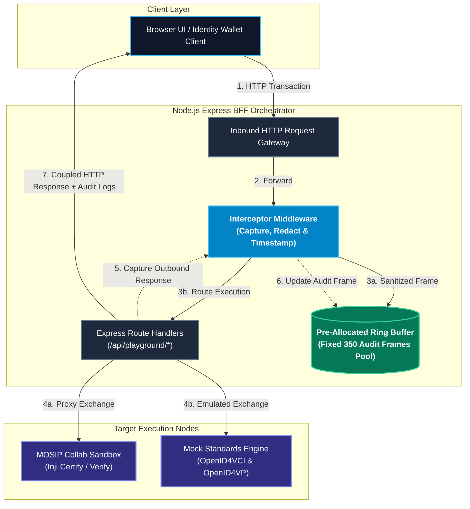
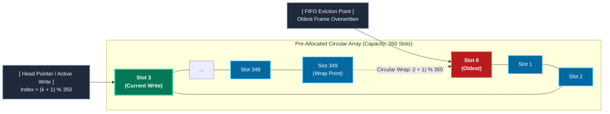
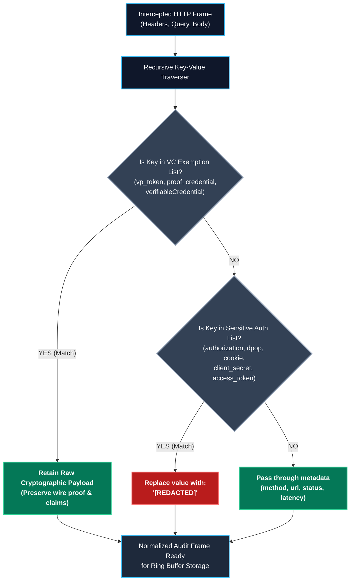
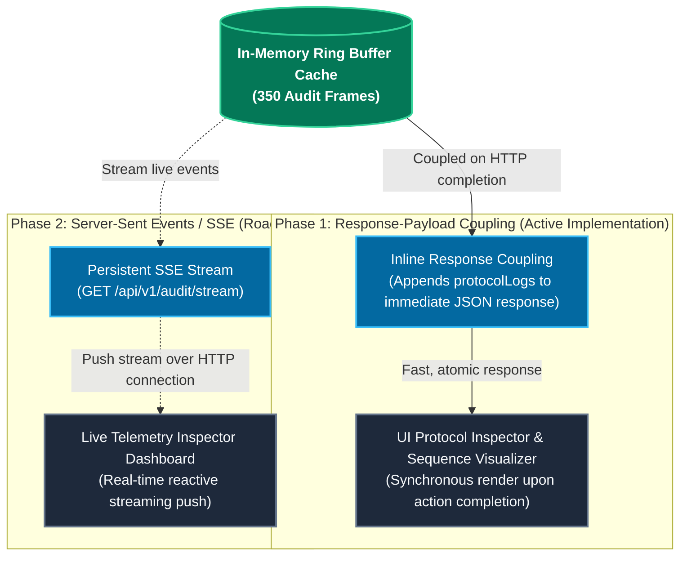
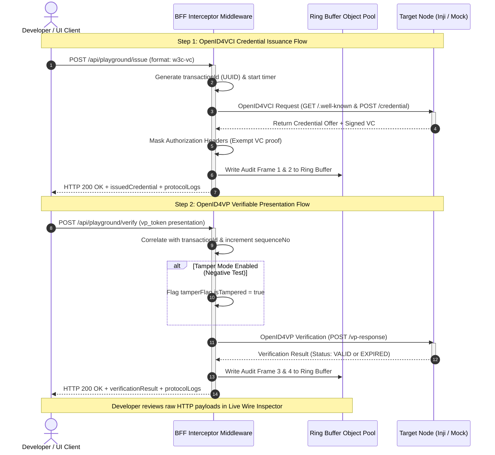

# Architecture Design Document: In-Memory Protocol Audit Logger
### MOSIP VC Interoperability Playground

This document provides the formal architectural specifications and interactive **Mermaid.js** diagrams for the **In-Memory Protocol Audit Logger**, embedded within the Node.js / Express Backend-For-Frontend (BFF) Orchestrator.

---

## 1. System Overview & Interceptor Pipeline

The In-Memory Protocol Audit Logger functions as an inspection engine embedded directly within the Express BFF Orchestrator. Operating as an HTTP middleware interceptor, it transparently captures, sanitizes, and buffers inbound and outbound network traffic passing between the client UI, mock standards engines, and the MOSIP Collab Sandbox.



---

## 2. Memory Management: Pre-Allocated Circular Ring Buffer

To prevent V8 garbage collection pauses, memory leaks, and dynamic reallocation overhead under continuous evaluation workloads, the logger employs a pre-allocated fixed-size circular array object pool of **350 Audit Frames**.

### Sizing Model & Eviction Semantics:
* **Capacity**: Exactly 350 fixed slots (`Array(350)`).
* **Flow Sizing**: Average end-to-end VC transaction (Issuance or Presentation) generates 4 to 5 network frames.
* **Concurrency**: Preserves the complete audit history for approximately **70 concurrent user flows**.
* **Zero-Allocation Overwrites**: Uses a circular write pointer `pointer = (pointer + 1) % 350` to overwrite expired slots in $O(1)$ constant time.



---

## 3. Security & Redaction Pipeline (Selective VC Retention)

Standard security logging naively redacts all sensitive tokens, which breaks identity testing tools by hiding verifiable presentations. The Interceptor enforces a **Strict VC Exemption Rule**:

* **Redacted**: Authentication tokens (`Bearer`, `dpop`), cookies, client secrets, and OAuth assertions.
* **Exempt / Retained**: Cryptographic identity proofs (`vp_token`, `verifiableCredential`, `proof`, and claims).



### Redaction Rules Reference:

| Domain | Keys Monitored | Sanitization Action |
|:-------|:---------------|:--------------------|
| **HTTP Transport Headers** | `authorization`, `dpop`, `cookie`, `set-cookie` | Value replaced with `"[REDACTED]"` |
| **OAuth / OIDC Credentials** | `client_secret`, `access_token`, `refresh_token`, `id_token`, `client_assertion` | String replaced with `"[REDACTED]"` |
| **Verifiable Credential Payloads** | `vp_token`, `credential`, `verifiableCredential`, `proof`, `claims` | **EXEMPT**: Retained unredacted for developer inspection |

---

## 4. Frontend Telemetry Delivery Models

The architecture supports dual delivery models to feed live network telemetry to the browser client:



---

## 5. End-to-End Protocol Audit Sequence Diagram

Here is the complete end-to-end sequence showing how the Audit Logger transparently captures a two-party OpenID4VCI / OpenID4VP transaction and correlates telemetry across each specification step:



---

## 6. Audit Frame JSON Specification

Every frame in the ring buffer adheres to the normalized schema below:

```json
{
  "transactionId": "tx-8f9b2c3d-4e5f-4321-ba98-123456789abc",
  "sequenceNo": 3,
  "isSandbox": true,
  "origin": "holder-wallet-app",
  "destination": "verifier-backend",
  "tamperFlag": {
    "isTampered": true,
    "message": "Signature verification failed: DPoP proof HTTP method mismatch."
  },
  "protocolContext": {
    "protocol": "OpenID4VP",
    "complianceStandard": "OID4VP Draft 21",
    "credentialFormat": "w3c-vc",
    "specStep": "Authorization Response Verification"
  },
  "packet": {
    "latencyMs": 142,
    "request": {
      "method": "POST",
      "url": "https://verify.collab.mosip.net/v1/verify/presentation",
      "headers": {
        "content-type": "application/x-www-form-urlencoded",
        "authorization": "[REDACTED]"
      },
      "body": {
        "vp_token": "eyJhbGciOiJFUzI1NiIs..."
      }
    },
    "response": {
      "statusCode": 200,
      "headers": {
        "content-type": "application/json"
      },
      "body": {
        "status": "VALID"
      }
    }
  }
}
```
